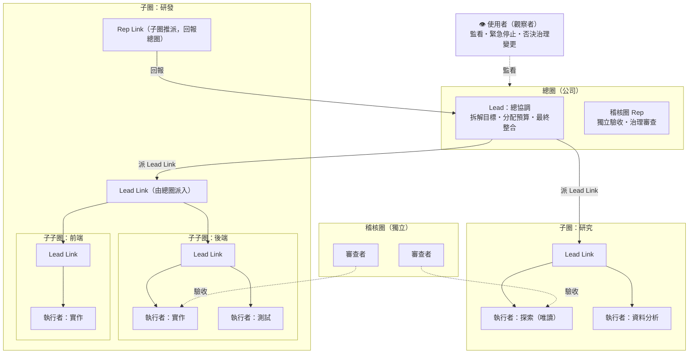
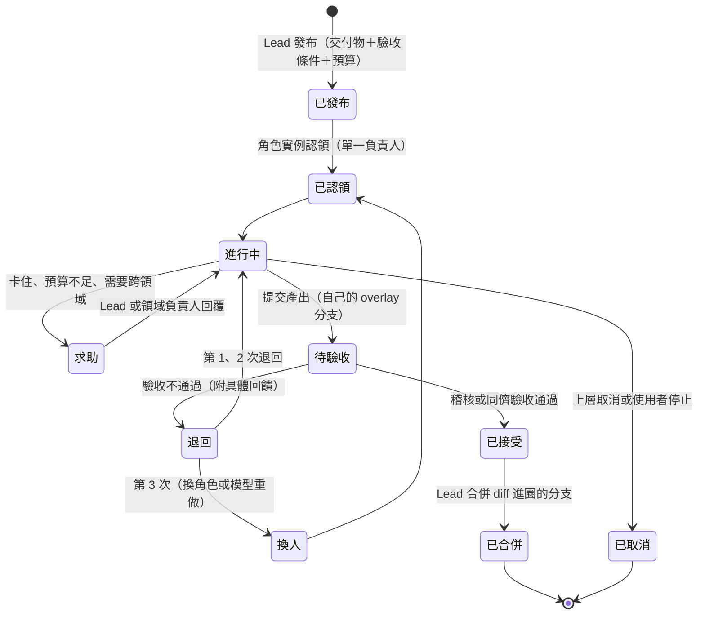
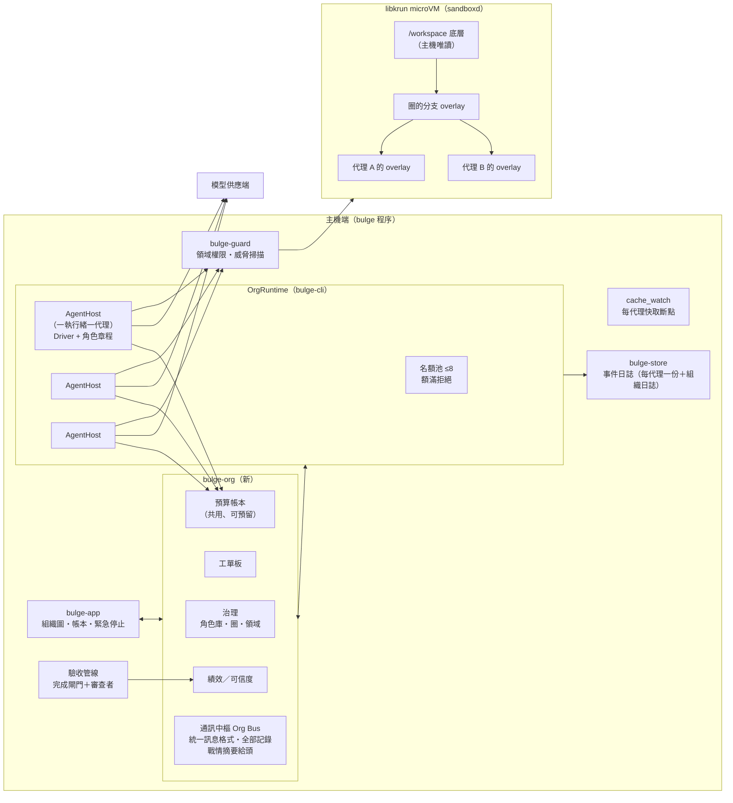
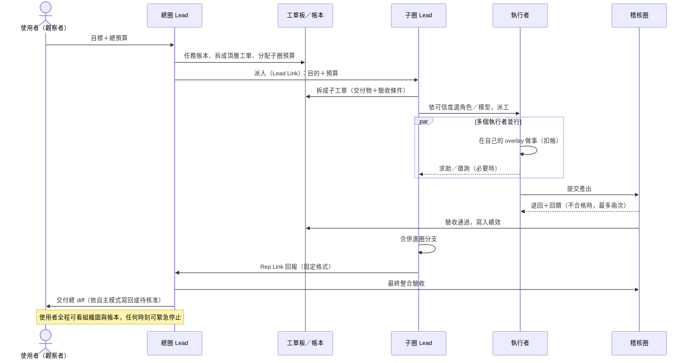

# Bulge 公司模式 — 扁平化代理組織設計（草案 2026-10-22）

> 目標：讓 bulge 能像一家**扁平化公司**一樣運作——一個總目標底下有多個團隊、團隊底下還有團隊，
> 代理彼此招募、協作、審查、替換，而使用者只需**監看**。
>
> 對應等級：**Bessemer L5（代理團隊）→ L6（代理管理代理團隊）**，人的角色達到
> **Feng et al. L5（觀察者）**。本文件延續 [CORE.md](CORE.md)（單一代理 L4）。

---

## 0. 等級定義與驗收

| 框架 | 等級 | 原文定義 | bulge 的驗收方式 |
|---|---|---|---|
| Bessemer | L5 代理團隊 | 多個代理共享上下文、協同執行，達成共同目標 | 一個目標由 ≥3 個不同角色的代理協作完成，各自產出經他人驗收後整合 |
| Bessemer | L6 管理代理團隊 | 代理能招募、評估、指揮其他 AI，給回饋，必要時替換 | 管理者依績效選角色與模型；不合格的產出被退回或換人重做，全程無人介入 |
| Feng et al. | L5 觀察者 | 代理完全自主，使用者只監看、可緊急停止 | 評估集上「人工介入次數 = 0」，且完成率不低於協作模式 |

**現況**：bulge 是 Bessemer L4、Feng L4（核准者）。子代理在能力階梯上是 L1：只有一個同步的
`delegate` 工具，深度 1，同一輪多次呼叫時依序執行，預算不算進父代理（見第 9 節）。

---

## 1. 研究結論：一家好的扁平化公司靠什麼運作

扁平化不是「沒有結構」，而是**層級少、權力下放、結構寫明白**。研究過的組織與教訓：

| 來源 | 機制 | 教訓 / 對 bulge 的意義 |
|---|---|---|
| **Holacracy** | 巢狀的「圈」(circle)；圈有目的、領域、職責；**上級派 Lead Link 進子圈，子圈選 Rep Link 回上級**；治理會議與營運分開；用「整合式決策」改結構 | 團隊之下有團隊，但每個圈自主；結構變更走獨立流程 |
| **Morning Star（CLOU）** | 沒有主管也沒有職稱；每人寫一份「同事承諾書」：使命、角色、**決策權（行動／建議／決定）**、績效指標，與上下游同事協商 | 用「承諾」取代「職位」；決策權寫明白 |
| **海爾 人單合一** | 數千個自負盈虧的小微企業，透過**內部市場**互相交易，共用平台資源 | 預算就是內部貨幣；團隊對自己的成本負責 |
| **Buurtzorg／Laloux 的 teal 組織** | 10–12 人的自主團隊；教練只提問、不做決定；**建議流程**：誰都能決定，但要先問受影響的人和專家 | 決策下放，但跨領域要先徵詢意見 |
| **Valve** | 沒有人向誰匯報；**自己選專案**；臨時的跨職能小組；同儕評審和排名決定報酬 | 自選工作需要搭配同儕評審，否則失控 |
| **Amazon 雙披薩團隊** | 團隊小於約 10 人；6 人有 15 條溝通線，12 人有 66 條 | 團隊大小要設上限 |
| **Bridgewater** | **可信度加權決策**：反覆在該領域成功、且能說清理由的人，意見權重更高 | 用績效紀錄決定誰的判斷算數 |
| **Magentic-One** | 協調者維護「任務帳本」（事實、推測、計畫）和「進度帳本」；進度停滯就重新規劃；專家代理之間不直接對話 | 帳本要明確寫下；停滯要能偵測 |

**失敗的教訓同樣重要：**
- **Zappos 推行 Holacracy** 後協調困難、紀錄和治理負擔重，最後改回有「領導者」的結構。
  多數成功的「扁平」組織其實只是減少層級、把權力下放，仍保留足夠的協調結構。
- **Spotify 的 squad 模型**只停留在理想，從未完整落實；高度自主卻沒有協作和引導機制，造成時間浪費、知識不流通。
- **扁平組織會長出隱形的權力結構**：不寫明白的結構，最後由非正式的權力填補。
- **多代理 LLM 系統的失敗研究（MAST, 2025）**：1600 多份紀錄、14 種失敗模式，主要來自
  **系統設計問題、代理間不一致、驗收不足**，而不只是模型能力不夠。
- **TheAgentCompany**（模擬一家軟體公司的 175 個任務）：最好的代理也只能自主完成約 30%，
  平均每題 27 次 LLM 呼叫、約 4.2 美元；社交溝通和複雜辦公軟體最弱。

### 1.1 由研究推出的十條設計原則

1. **角色，不是職位**：代理是角色的實例；角色由「目的、領域、職責、決策權」定義（Holacracy、CLOU）。
2. **巢狀的圈，不是指揮鏈**：團隊之下可以有團隊，但每個圈自主決定怎麼做（Holacracy）。
3. **結構寫明白**：所有角色、領域、決策權、預算都是寫下來的檔案，不留給非正式權力（Zappos、隱形權力的教訓）。
4. **每張工單只有一個負責人**，交付物和驗收條件在開工前寫好（Amazon 單一負責、bulge 交付契約）。
5. **小團隊**：一個圈最多 7 個成員（雙披薩、溝通線數）。
6. **預算是內部貨幣**：每個圈對自己的花費負責，花費一路往上扣（海爾）。
7. **建議流程**：在自己的領域內自己決定；要動別人的領域，必須先徵詢該領域的負責角色（Buurtzorg）。
8. **完全透明**：任務帳本、進度帳本、預算帳本所有代理都查得到（Bridgewater、Magentic-One）。
9. **不准自己審自己**：每個交付物都由另一個角色驗收；績效累積成可信度，決定誰接什麼工作、誰的判斷算數（Valve、Bridgewater）。
10. **營運和治理分開**：做事走工單；改結構（新增角色、拆分或解散圈）走治理流程，要「安全可試、可撤回」（Holacracy）。

---

## 2. 組織結構

### 2.1 結構圖



### 2.2 元素定義

| 元素 | 定義 | 上限（預設，可設定） |
|---|---|---|
| **圈 Circle** | 一組角色＋目的＋領域＋預算。可包含子圈 | 每圈 ≤ 7 個成員；巢狀 ≤ 3 層 |
| **Lead Link** | 由上一層派入，負責把目的拆成工單、指派角色、分配預算。**不親自做事、不能改檔案** | 每圈 1 個 |
| **Rep Link** | 子圈推派到上一層，負責向上回報、提出子圈遇到的阻礙 | 每圈 1 個（小圈可與 Lead 同一代理） |
| **執行者 Worker** | 實際做事的角色實例。不能再招募 | — |
| **稽核圈** | 獨立於所有業務圈；負責驗收與治理審查，自己不接業務工單 | 審查者 ≤ 3 |
| **領域 Domain** | 圈或角色「擁有」的資源：檔案路徑萬用字元、網域、工具 | 互不重疊；跨領域要走建議流程 |
| **觀察者** | 使用者。看得到一切，可以緊急停止任何節點、否決治理變更 | — |

**代理數量上限**（2026-10-22 定案，數值在 O1 壓力測試後校正）：

| 上限 | 預設 | 可調最大 | 依據 |
|---|---|---|---|
| 同時在跑 | 8 | 64（且 ≤ VM vCPU × 4） | 代理大部分時間在等模型回應，指令執行只佔一小段；參考 deepseek-harness 8、hermes 10、openclaw 8／群集 32 |
| 單一目標累計 | 100 | 1,000 | 參考 openclaw 群集 200、deepseek-harness workflow 1,000；實際由總預算先卡住 |
| 組織理論容量 | — | 1 + 7 + 49 + 343 ≈ 400 個角色位置 | 3 層巢狀 × 每圈 7 成員 |

各層的實際限制：DeepSeek API 的並行上限是 flash 2,500、pro 500，不是瓶頸；主機端每個代理只是一個執行緒，
數百個也沒問題；**真正的限制是 VM 的 CPU／記憶體（同時跑的指令）和總預算**。公司模式下 VM 預設改為
16 vCPU／32 GiB（本機 20 核、60 GiB）。額滿時拒絕新的派工，讓上層自己決定先後，不排隊。

---

## 3. 制度

### 3.1 角色章程（取代職位）

每個角色一個檔案 `~/.bulge/harness/org/roles/<name>.md`（內建 explorer、implementer、reviewer、lead 四個角色，同名檔案可覆寫），形式參考 Morning Star 的同事承諾書：

```yaml
---
name: backend-implementer
purpose: 依工單實作後端功能並附可執行的驗證
domain: ["src/server/**", "tests/server/**"]   # 擁有的路徑；其他路徑要走建議流程
accountabilities:                              # 職責
  - 每次交付都附上跑過的測試與結果
decision_rights:                               # 行動 / 建議 / 決定
  act: [edit_in_domain, run_tests]
  recommend: [api_shape]
  decide: []
tools: [read, write, edit, exec, grep, glob]   # 工具白名單
model: deepseek-flash
reasoning_effort: medium
budget_share: 0.15                             # 佔所屬圈預算的上限比例
kpis: [acceptance_rate, rework_rate, cost_per_ticket]
---
（角色的工作指引：怎麼做、什麼算做好、常見陷阱）
```

- **角色章程就是這個角色的 system prompt**。同一個角色的所有實例，開頭和工具清單都一字不差，
  所以彼此能共用快取（延續今天的快取設計）。
- 新角色只能由治理流程產生（3.7），不能在營運中臨時亂開。

### 3.2 工單與承諾



工單欄位：`id、上層工單、所屬圈、負責人（一個）、目的、交付物、驗收條件、預算（步數／token／時間）、
相依工單、狀態、產出物路徑、驗收紀錄`。交付物和驗收條件直接沿用現有的 `Contract` 和完成閘門的機械檢查。

### 3.3 內部市場與預算

- **預算帳本**是全公司共用的一本帳，以**美元等值**記帳（用今天建立的價目表：未命中、命中、輸出分開計價）。
- 預算由上往下**分配**：總預算 → 各子圈 → 各工單。花費由下往上**扣帳**。
  任何節點都不能花掉超過分到的錢；所有層級加總絕不超過使用者設定的總上限。
- **超支要申請**：執行者用「求助」向 Lead 申請追加，Lead 只能在自己的額度內核給；需要更多就再往上申請。
- **認領方式**：Lead 發布工單時列出符合條件的角色，依**可信度**（3.6）挑選角色和模型；
  可信度相近時選成本較低的。這是 Valve「自選專案」在 AI 上的版本：代理沒有偏好，所以由績效決定誰接。
- **不同任務用不同模型**（定案）：角色章程給預設模型，Lead 可依工單類型改派，模型可以來自不同供應商
  （bulge-llm 已支援 OpenAI 與 Anthropic 兩種協定、每個供應商各自的金鑰）。派工紀錄寫下「工單 → 角色 → 模型」，
  績效依這三者累積，之後同類工單自動偏向表現最好、成本最低的組合。

### 3.4 建議流程（決策權）

- 在**自己的領域**內，依角色的 `decision_rights` 自行決定和行動。
- 要動**別人的領域**（例如改另一個圈擁有的檔案），必須先送出「徵詢」給該領域的負責角色，
  附上提案和理由；對方可以同意、提修改或反對（需附理由）。逾時沒回應時，由共同的上層 Lead 裁決。
- 領域規則由 `bulge-guard` 的權限規則強制執行，不靠模型自律。

### 3.5 透明帳本

| 帳本 | 內容 | 誰能寫 |
|---|---|---|
| 任務帳本 | 目標、已知事實、推測、計畫、工單樹 | Lead |
| 進度帳本 | 每張工單的狀態、最近進展、是否停滯 | 系統自動 |
| 預算帳本 | 分配、花費、剩餘、每張工單的成本 | 系統自動 |
| 決策紀錄 | 徵詢、反對、裁決、治理變更 | 相關角色 |

所有代理都能**查詢**帳本（用工具查，不是整本塞進上下文）。停滯偵測：工單連續 N 步沒有進展，
系統通知 Lead 重新規劃（Magentic-One 的外迴圈）。

### 3.6 驗收、可信度與替換

- **不准自己審自己**：產出由稽核圈或同圈的另一個角色驗收，先跑機械檢查，再做審查。
- 每次驗收結果都寫入**績效紀錄**：`角色 × 模型 × 工單類型 → 接受率、重工率、平均成本、平均時間`。
- **可信度** = 接受率 × 樣本數的信心折扣，再依成本微調。用途：
  1. 派工時選角色和模型；
  2. 有分歧時加權判斷（Bridgewater）；
  3. 連續失敗的組合在該類工單上自動降級。
- **替換**：同一張工單被退回第 3 次時，停掉目前的實例，換角色或換模型重來，退回的回饋一併交給新的負責人。

### 3.7 治理流程（改結構）

- 任何代理都能提出「張力」（tension）：目前的結構不適合手上的工作，例如缺一個角色、某個圈太大、領域劃分不清。
- 由所屬圈的 Lead 擬出變更提案（新增或修改角色、拆分或解散子圈、調整領域）。
- **稽核圈審查**：只看兩件事：會不會造成傷害、能不能撤回（「安全可試」）。沒有實質反對就通過。
- 變更寫進 `~/.bulge/org/` 的版本紀錄，**使用者可以否決**任何治理變更。
- 新角色在第一次使用時降低預算上限，累積可信度後才放寬。

### 3.8 升級規則（什麼時候叫醒使用者）

只有以下情況會通知觀察者，其餘一律自主處理：

0. **真實世界的動作一律要人**（定案）：付款、刷卡、下單等金融交易；輸入或使用真實的個人資料、帳密、證件；
   對外送出且無法撤回的動作（寄給真人的信、對外發布、正式提交）。這類工具與網域在角色章程和網路閘門中標為
   「真實世界」，任何自主等級都不能自動執行；
1. 總預算用掉 80%；
2. 頂層工單停滯，重新規劃兩次仍無進展；
3. 高風險動作：寫回主機（依自主模式而定，見第 10 節）、連往未允許的網域、刪除大量檔案；
4. 稽核圈對治理變更提出反對；
5. 偵測到疑似提示注入在組織內擴散。

### 3.9 通訊中樞：讓「頭」永遠知道全局（定案）

不同模型之間、不同層級之間的溝通全部經過一個**通訊中樞（Org Bus）**，不讓代理私下傳話：

- **統一訊息格式**：每則訊息都是結構化的 `{寄件者, 收件者, 工單, 類型（回報／求助／徵詢／裁決／警報）, 摘要, 附件路徑}`。
  不管寄件者是哪個模型，收件者看到的格式都一樣，避免不同模型之間的理解落差。
- **全部記錄**：每則訊息寫進組織日誌，並經過威脅掃描和機密遮蔽。
- **戰情摘要給頭**：中樞從工單板、進度帳本和預算帳本**機械式彙整**（不呼叫模型，所以不花 token）出一份精簡的戰情摘要，
  在總圈 Lead 每一輪開始時附上：各圈進度、停滯工單、預算消耗、警報。頭要細節時再用工具查詢。
- **立即通知**：警報類訊息（預算告急、停滯、注入嫌疑、需要人類）會插隊，在頭的下一輪立即送達。
- **使用者同步看到**：同一份戰情摘要就是 App 組織圖頁面的資料來源。

---

## 4. 執行架構（對應 bulge 程式碼）

### 4.1 元件圖



### 4.2 模組對應

| 新設計的元件 | 落在哪裡 | 沿用的現有元件 |
|---|---|---|
| 角色、圈、領域、工單、帳本的資料模型與規則 | **新 crate `bulge-org`**（純邏輯，可單元測試） | `bulge-harness` 的 `Tree` 版本化、`profile` 的有界儲存 |
| 組織事件（發布、認領、提交、驗收、退回、扣帳、徵詢、治理變更） | `bulge-store` 新增事件型別；另開一份組織日誌 | 只追加的 JSONL、崩潰恢復 |
| 共用預算帳本（分配、預留、扣帳、超支拒絕） | `bulge-org::ledger`，以 `Arc<Mutex>` 共享給所有 driver | `bulge-core::budget::BudgetTracker`（改成向帳本扣帳） |
| 代理宿主、名額池、連鎖停止 | `bulge-cli` 的 `OrgRuntime`：一個代理一個執行緒（driver 不能跨執行緒），用 channel 溝通 | App 現有的「一 session 一執行緒」模式、`CancellationToken` |
| 工單板、郵件、徵詢等主機端工具 | `bulge-core` driver 的主機工具（和 `plan`、`recall`、`delegate` 同一條路） | `DelegateHandler` 擴充成非同步的組織介面 |
| 每代理的工作區分支 | `sandboxd`：在同一台 VM 內疊加 overlay（底層 → 圈分支 → 代理分支）；新增「合併上一層」指令 | 現有的 `/workspace` overlay、`changes::collect/render_diff` |
| 每代理的 VM 內沙盒（定案：不另開 VM；O3 已實作） | `sandboxd`：權限分離的特權助手（降權前啟動，只接受 open/changes/export/merge/close）。每個工作區有自己的 mount、PID、IPC、網路 namespace 與自己的 /proc（網路只有 loopback；對外經主橋接的 unix socket 轉發，仍受雙金鑰閘道與白名單檢查），只看得到自己的 overlay 和自己的程序；看不到 `/run/bulge`（其他工作區、主 upper、控制 socket）；RLIMIT 限制程序數與檔案數；以工作區擁有者身分執行（才能修改既有檔案），隔離靠 namespace 而非不同 uid。合併時 root 只做掛載：讀工作區時進入它的 mount namespace 並降權，寫主工作區時降成主工作區擁有者，拒絕符號連結父目錄與 setuid 位元；同樣的變更視為已收斂，不同的變更才算衝突。關閉＝殺掉 PID 1，整個工作區的程序一併結束 | 現有的非 root 降權、`no_new_privs`、Landlock |
| 領域強制 | `bulge-guard` 由角色章程產生權限規則 | `permission.rs`（最後符合者優先） |
| 代理間訊息的注入防護 | 每則組織內訊息都過 `threat_scan`、`redact` | `threat.rs`、`redact.rs` |
| 驗收 | 機械檢查＋審查者角色＋評審模型 | `complete.rs`、`eval.rs` 的盲評 |
| 績效與可信度 | `bulge-harness::usage` 擴充 | 技能使用台帳 |
| 快取 | 角色章程當固定開頭、工單放每輪內容、接續模式承接 Lead 的對話 | 今天完成的 `<turn-context>`、`side_request`、`cache_watch` |
| 組織圖、帳本、單點停止 | `bulge-app` 新頁面 | 現有的事件串流 UI |

### 4.3 工作區分支（為什麼不用 git worktree）

hermes 和 openclaw 用 git worktree 隔離子代理。bulge 的優勢是 VM 本來就用 overlay：

- **分支 = 疊一層 overlay**：代理的寫入只落在自己那一層，看得到圈分支和底層。
- **合併 = 把代理層的變更搬進圈分支**：Lead 先看 diff（現有的 `render_diff`），衝突時退回負責人處理。
- **交付 = 總圈分支的 diff**，這就是現有寫回主機的路徑，安全模型完全不變：
  **只有總圈的最終整合會碰到主機**。
- 不需要工作區是 git repo，任何資料夾都適用。

---

## 5. 一個目標的生命週期



---

## 6. 防失控

| 風險 | 防線 |
|---|---|
| 無限招募 | 巢狀 ≤3 層、每圈 ≤7 成員、全公司同時 ≤8 個代理；執行者不能招募；角色只能由治理流程新增 |
| 花費失控 | 共用帳本、預算由上往下分配、超支拒絕；總預算是硬上限 |
| 互相等待卡死 | 每張工單和每次徵詢都有逾時；逾時由共同上層裁決；工單相依必須無環（發布時檢查） |
| 錯誤層層放大 | 每一層都驗收，不直接相信下層的回報；Lead 合併前先看 diff |
| 上下文爆炸 | 回報固定格式；摘要長度依上層剩餘上下文動態限制，細節存檔再給路徑 |
| 提示注入擴散 | 組織內每則訊息都過威脅掃描；可疑內容隔離並升級給使用者 |
| 越權 | 領域由權限規則強制；執行者看不到其他圈的金鑰或設定；只有總圈整合碰主機 |
| 真實世界動作 | 工具與網域依 ~/.bulge/real_world.json（或內建預設）標記；任何自主等級都不自動執行：工具呼叫被拒並記錄 ApprovalAsked、閘道拒絕或（App 協作模式）逐次詢問；需要詢問的工具呼叫一律不執行（fail closed） |
| 隱形權力 | 所有決策權寫在角色章程；所有裁決進決策紀錄 |
| 程序或代理當機 | 所有狀態事件化；重開後從組織日誌恢復；進行中的工單標記中斷、交回 Lead |

---

## 7. 對照 MAST 的三類失敗

| MAST 類別 | 典型症狀 | 本設計的對策 |
|---|---|---|
| 系統設計問題 | 角色不清、規格不明、忘記停止條件 | 角色章程、工單的交付物和驗收條件、預算與逾時 |
| 代理間不一致 | 各做各的、資訊沒傳到、重複勞動 | 單一負責人、透明帳本、建議流程、上下級固定格式回報 |
| 驗收不足 | 過早宣告完成、錯誤沒被抓到 | 不准自審、稽核圈、機械檢查、退回與替換 |

---

## 8. 評估

- **目標基準：TheAgentCompany**（模擬軟體公司的 175 個任務，涵蓋工程、專案管理、HR、財務）。定案：要下載。
  - 需要：docker＋docker compose（本機只有 podman → 用 podman 的 docker 相容 socket）、30 GB 以上磁碟（本機剩 755 GB）、host networking。
  - 下載量主要是 GitLab、ownCloud、Plane、RocketChat 的映像；實測 Docker Hub 約 5.8 MB/s、GitHub 約 1.5 MB/s，30 GB 約 1.5 小時。
  - **要解決的衝突**：這些服務跑在主機上，而 bulge 的出口閘道刻意擋掉主機與私網 IP。評估時要有明確的「評估模式」，
    只對這幾個服務的位址放行，不能放寬一般執行時的規則。
- **必量指標**：完成率、部分完成分數、每題成本（美元，依價目表）、每題時間、**人工介入次數**、
  越界次數（必須為 0）、快取命中率。
- **對照組**：同一批題目由單一代理（現在的 L4 bulge）完成，證明組織模式真的比較好，
  而不只是比較貴。
- **消融實驗**：關掉稽核圈、關掉建議流程、關掉可信度派工，各量一次，確認每個制度都有貢獻。

---

## 9. 現有子代理的缺口（O1 要先補）

| 缺口 | 影響 |
|---|---|
| 子代理預算不算進父代理 | 頂層預算管不住總花費，違反「預算是硬上限」 |
| 同一輪多個委派依序執行 | 無法並行，長任務很慢 |
| 任務寫在 system prompt | 子代理之間、與父代理之間都無法共用快取 |
| 子代理沒有記憶、技能、`recall` | 學到的東西傳不下去 |
| 回傳只有最終文字、沒有長度上限 | 沒有狀態、花費、截斷標記，可能撐爆父代理上下文 |
| 共用工作區、沒有衝突處理 | 一旦並行就會互相覆蓋 |

---

## 10. 分階段實作

| 階段 | 內容 | 達到 | 驗收 |
|---|---|---|---|
| **O1 基礎** | 共用預算帳本；同輪並行與名額池；連鎖停止；結構化回報（狀態、結束原因、花費、截斷） | 子代理階梯 L3 | 並行委派的總花費 ≤ 頂層預算；停止父代理時所有下層同時停 |
| **O2 單層團隊** | `bulge-org`；角色庫；工單板；上下級通訊；角色章程當固定開頭 | **Bessemer L5** | 一個目標由 ≥3 個角色協作完成；同角色實例之間快取命中 |
| **O3 分支工作區** | 疊加 overlay；Lead 審 diff 合併；領域權限 | 子代理階梯 L4 | 兩個執行者並行改不同領域零衝突；跨領域修改必經徵詢 |
| **O4 管理** | 稽核圈；退回與替換；績效與可信度；內部市場派工 | **Bessemer L6（單層）** | 故意注入錯誤的產出會被退回或換人，且全程無人介入 |
| **O5 巢狀** | 子圈之下再有子圈；Lead／Rep Link；治理流程 | **完整公司** | 三層組織完成一個多部分目標；治理變更可提出、審查、撤回 |
| **O6 觀察者** | 升級規則；組織圖 UI；交付政策；評估集 | **Feng L5** | 評估集上人工介入次數 = 0，完成率不低於單一代理 |

每個階段結束都要在 VM 裡跑真實的長任務驗收，不以單元測試代替（延續 CORE.md 的規則）。

---

## 11. 已定案與待決事項

**2026-10-22 定案：**

1. **觀察者模式下可以自動寫回**（全自動模式：寫回前打快照、可一鍵回復、留完整稽核紀錄）；
   但**真實世界的動作一律要人**（付款、刷卡、真實個資與帳密、無法撤回的對外動作），見 3.8 第 0 條。
   PLAN.md 的「所有寫回皆經審批」改為：預設模式維持審批；全自動模式改由快照與稽核保障。
2. **允許不同模型**，可以來自不同供應商。
3. **代理數量**：同時 8（最大 64）、單一目標累計 100（最大 1,000），見 2.2；O1 壓力測試後校正。
4. **不同任務用不同模型**；中間的溝通經**通訊中樞**，並給頭一份機械彙整的戰情摘要，見 3.9。
5. **子代理用 VM 內的沙盒**，不另開 VM，見 4.2。
6. **評估工具要下載**：TheAgentCompany，見第 8 節。

**仍待決：**

- **角色來源**：只用預先定義的角色庫，還是允許治理流程產生新角色（提議：允許，但需稽核圈審查，使用者可否決）。

---

## 12. 實作狀態與驗證（2026-10-22）

O1–O5 已實作並提交；O6（Feng L5 觀察者：組織圖 UI、評估集）尚未開始。

| 階段 | 提交 | 內容 |
|---|---|---|
| O1 | `1710edf` | 共用預算帳本（花費往上扣、子帳本受祖先剩餘額度限制）、同輪並行、連鎖停止、結構化回報 |
| O2 | `44c3739` `46914a9` | `bulge-org`（角色章程、工單板、通訊中樞）；依角色委派、`org_status` |
| O3 | `8208e62` | VM 內每代理工作區（權限分離助手；mount+PID+IPC namespace；降權合併、衝突偵測） |
| O4 | `1100e04` `7293b51` | 獨立審查（暫存工作區重放）、退回回饋給同一工作者、依可信度換模型、績效紀錄 |
| O5 | `640b0c5` `347fe38` | 團隊之下有團隊（深度 3、總代理數上限）；治理（提議→機械驗證→稽核→試用→可否決） |
| 安全 | `71cbfc3` | Ask 預設拒絕並記錄；真實世界動作（MCP 工具、付款網域）一律要人 |
| 安全 | `7c8c718` | 每個工作區獨立網路 namespace（補上工作區間本機服務可互連的缺口）|
| O6 | `993b4af` | 觀察者面板：組織圖（工單樹 + 狀態 + 花費）、需要關注清單、點進子代理逐字稿、戰情摘要；`--writeback`；評估腳本 |

### Bessemer L6 對照（原文：「代理能招募、評估、指揮其他 AI，給回饋，必要時替換」）

| 能力 | 機制 | 實機證據（DeepSeek flash） |
|---|---|---|
| 招募 | 角色庫＋依可信度（拉普拉斯平滑、成本次排序）選角色與模型；Lead 可再招募 Lead；可提議新角色 | 總經理→研發主管→兩個實作者（同一秒開工）；`doc-writer` 經稽核以試用身分安裝並立即使用 |
| 評估 | 審查者在已重放工作者變更的暫存工作區獨立驗收，自身修改一律丟棄；不准自審 | 每張有變更的工單都經 reviewer 判定才合併 |
| 指揮 | 工單（單一負責人、交付物、驗收條件、預算子帳本）、通訊中樞、戰情摘要 | 4 張工單各帶 5–8 條驗收條件；`org_status` 機械彙整 |
| 回饋 | REJECT 的具體回饋交回同一工作者、同一工作區重做 | 工單歷程：交件→退回→重新開工→交件→通過→合併；合併檔含審查要求的修改 |
| 替換 | 退回超過上限或執行失敗→換成可信度最高、未試過的模型；無可換則失敗 | 主模型不存在→失敗→換成 deepseek-flash→審查通過；績效簿此後優先選 flash |
| 團隊的團隊（L5→L6） | 子團隊工廠、範圍化工單板與戰情、Rep Link 回報 | 工單樹 t-1（lead）→ t-2/t-3/t-4（parent=t-1） |

### 安全驗證
`cargo test --workspace` 573 通過、`clippy -D warnings` 乾淨；VM 探測：`slot_probe` 32/32、`escape_probe` 18/18（0 失敗）、`gateway_probe`、`drop_probe`、`landlock_probe` 皆通過；真實世界閘門實機：`create_order` 被擋（伺服器端副作用未發生）、`api.stripe.com` 被拒、一般工具與網站照常可用。

### 量化評估一:L6 機制跨多次執行的彙整

L6 的五個動詞不是靠單一示範,而是在 **16 次真實組織執行**(O2–O6 的實跑＋評估集,全部 deepseek-flash)留下的工單／通訊／績效日誌中彙整量得。重跑:`python3 scripts/org-metrics.py <job 儲存目錄>`。

| 指標 | 數值 |
|---|---|
| 執行次數 / 委派工單總數 | 17 / 53 |
| 招募:不同角色 | 8 種(含治理新增的 doc-writer) |
| 招募:不同(角色×模型)組合 | 8 |
| 指揮:達到的組織層數 | **3**(總經理 → 部門 Lead → 執行者) |
| 指揮:有並行(≥2 併發同層)的執行 | 7 次(單次最多 3 個併發) |
| 規模:最大單次組織 | 17 張工單、3 部門並行、6 個模組交付(miniutils) |
| 評估:改檔工單中經獨立審查的比例 | 15/23(其餘為探索類純回報工單與 Lead 整合工單,無交付物可獨立審) |
| 回饋:退回→重做循環 | 8 |
| 替換:換角色／換模型 | 11 |

這些是機制「確實被觸發」的計數,不是品質分數;品質見下一節。

### 量化評估二:TheAgentCompany（第三方基準）

用 TheAgentCompany（arXiv 2412.14161，模擬一家軟體公司的 175 任務）的**官方加密評分器**實測 bulge 組織模式（模型 deepseek-flash）。bulge 不走它的容器內 runner（bulge 自己開 microVM），而是用任務映像的輸入＋評分器、原生執行，見 `scripts/tac-eval.sh`。

| 任務 | 得分 | 說明 |
|---|---|---|
| ds-sql-exercise | **6/6** | SQL 查詢三題，全對 |
| hr-check-attendance-one-day | **3/3** | 考勤彙整，產出 xlsx（代理自行 pip install openpyxl） |
| hr-check-attendance-multiple-days-department | **3/3** | 部門別多日彙整 |
| hr-check-attendance-multiple-days | **1/4** | 檔名＋欄位 ✓；統計 ✗（2 名員工的準時下班數邊界判定錯誤）；另 1 分為「瀏覽 owncloud」檢查點，檔案就地提供的設定下不適用 |
| **合計** | **13/16 檢查點** | 誠實的高低分布；多日那題是真實的邏輯錯誤 |

**範圍界定（重要）**：只跑「評分器只讀 /workspace、輸入是檔案」的任務。bulge 刻意封鎖主機／區網位址，而 TheAgentCompany 的多數任務要瀏覽跑在主機上的服務（GitLab／ownCloud／RocketChat／Plane）——這些在此**依設計排除**，不是失敗。付款類的 Plane 任務另因 MinIO 映像各registry 皆已不公開而無法架設。故這是在 bulge 安全邊界內可乾淨執行的子集，非全 175 題。

### 已知限制
- MCP 工具只給頭與 Lead（伺服器在主機上，不在任何工作區內）。
- 整套 TheAgentCompany（含服務瀏覽任務）無法在 bulge 的安全邊界內乾淨跑完；量化僅限自足子集。
- 審查與績效以「角色 × 模型」計，尚未細分工單類型。


## 參考資料

- Bessemer 自主分級：<https://www.bvp.com/atlas/bessemers-ai-agent-autonomy-scale>
- Feng, McDonald, Zhang — Levels of Autonomy for AI Agents：<https://arxiv.org/abs/2506.12469v1>
- Holacracy：<https://en.wikipedia.org/wiki/Holacracy>
- Morning Star 與 CLOU：<https://reinventingorganizationswiki.com/en/cases/morning-star> ·
  <https://opensource.com/business/12/8/colleague-letter-understanding-replacing-jobs-commitments>
- 海爾人單合一：<https://corporate-rebels.com/blog/international-rendanheyi-forum> ·
  <https://thebusinessprofessor.helpjuice.com/rendanheyi-model-explained>
- Buurtzorg 與建議流程：<https://www.infoq.com/articles/book-reinventing-organizations>
- Valve 員工手冊：<https://media.steampowered.com/apps/valve/Valve_Handbook_LowRes.pdf>
- Amazon 雙披薩團隊：<https://aws.amazon.com/ko/executive-insights/content/amazon-two-pizza-team/>
- Bridgewater 可信度加權決策：<https://p2pfoundation.net/Believability-Weighted_Decision_Making>
- Spotify 模型的失敗：<https://www.jeremiahlee.com/posts/failed-squad-goals/>
- Zappos 與 Holacracy：<https://fortune.com/2016/01/25/zappos-bosses-managers-holacracy>
- Magentic-One：<https://www.microsoft.com/research/articles/magentic-one-a-generalist-multi-agent-system-for-solving-complex-tasks>
- MAST — Why Do Multi-Agent LLM Systems Fail?：<https://arxiv.org/abs/2503.13657>
- TheAgentCompany：<https://arxiv.org/abs/2412.14161>
- DeepSeek API 並行上限：<https://api-docs.deepseek.com/quick_start/rate_limit>
