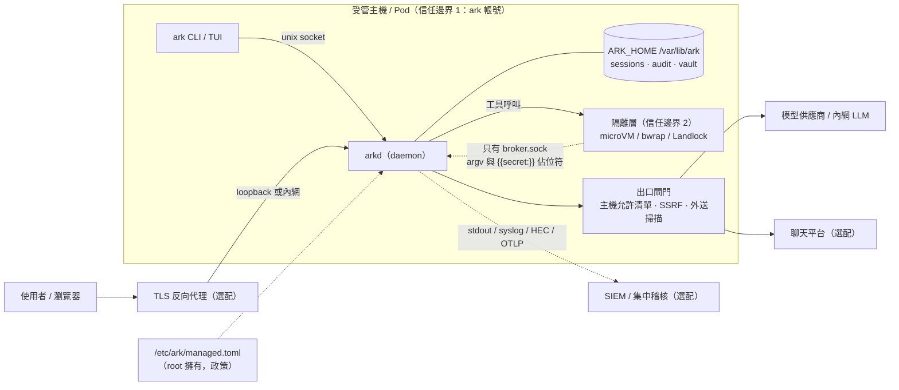
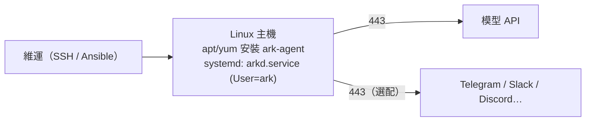
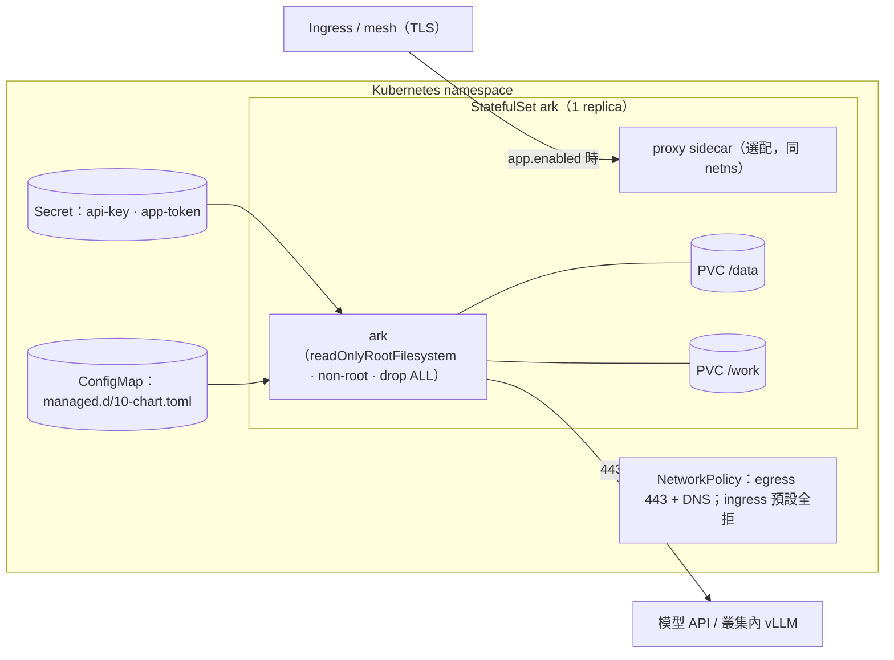
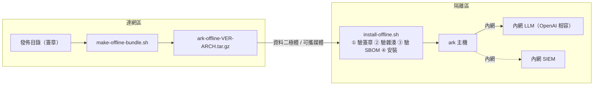
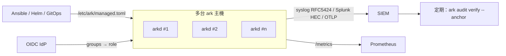

# 部署架構參考圖

四種參考架構。共通原則：ark 只主動往外連**你設定的**端點；app server 預設關閉；資料只在 `ARK_HOME`。圖用 Mermaid 寫（GitHub／GitLab 直接渲染），下方都附文字版的連線表。

## 0. 元件與信任邊界

| 邊界 | 誰強制 | 能擋什麼 |
|---|---|---|
| 1：ark 帳號 | OS（專用帳號、`ProtectSystem`、`NoNewPrivileges`） | ark 行程碰到主機其他部分 |
| 2：隔離層 | KVM／核心 namespace／Landlock | 工具執行碰到 daemon 記憶體、vault、主機家目錄 |
| 3：出口閘門 | daemon（資料驅動，不經模型） | 任何對外連線不在允許清單、指向內網、夾帶秘密 |
| 4：政策層 | `/etc/ark`（root） | 使用者或專案設定削弱組織政策 |

## 1. 參考架構 A：單機系統服務（最小）

| 項目 | 值 |
|---|---|
| 安裝 | `apt install ark-agent` 或 `dnf install ark-agent`（見 [install.md](install.md)） |
| 服務 | `arkd.service`（系統層），帳號 `ark`，狀態 `/var/lib/ark`，工作區 `/var/lib/ark/workspace` |
| 對內監聽 | **無**（app server 關閉）。互動用 `sudo -u ark ark chat`，或經聊天通道 |
| 對外連線 | 443 到模型 API 與你啟用的聊天平台；DNS |
| 金鑰 | 系統服務通常沒有登入 keyring：用 systemd `LoadCredential` 提供 `ARK_VAULT_KEY`，或密語檔 `ARK_VAULT_PASSPHRASE_FILE`；`ARK_VAULT_REQUIRE_ENCRYPTION=1` 防止悄悄退回明文 |
| 政策 | `/etc/ark/managed.toml`（範例 `/etc/ark/managed.toml.example`） |
| 備份 | `/var/lib/ark`（含 `config/secrets.enc`；金鑰來源要另外保管）|

## 2. 參考架構 B：容器／Kubernetes

| 項目 | 值 |
|---|---|
| 交付 | `deploy/helm/ark`（`helm lint`／`helm template` 已測）；映像三選一：`Dockerfile`（debian＋tini）、`Dockerfile.ubi`（UBI 9 minimal）、`Dockerfile.distroless`（無 shell） |
| 為何單副本 | daemon 擁有 session、vault、稽核檔的本機寫入權；兩個寫入者會毀損狀態。要擴量就多開 release |
| 設定 | `config.mode=setup`：init container 跑 `ark setup --non-interactive …`，金鑰經環境變數進 vault；`config.mode=file`：掛 ConfigMap（distroless 用）|
| 政策 | `managedPolicy` 掛為 `/etc/ark/managed.d/10-chart.toml`（root 擁有、0644，ark 的受管設定載入器只接受這種檔案）|
| app API | 預設關。開啟時 ark 綁 loopback，sidecar 在同一 network namespace 轉出；TLS 由 Ingress 終結；token 來自 Secret |
| Pod 安全 | 符合 `restricted` Pod Security Standard：`runAsNonRoot`、`seccompProfile: RuntimeDefault`、`allowPrivilegeEscalation: false`、`capabilities.drop: [ALL]`、`readOnlyRootFilesystem: true`、不掛 ServiceAccount token |
| 隔離層 | Pod 內通常**沒有** KVM 與 user namespace：agent 的工具會顯示 `NOT ISOLATED`（執行在 Pod 內）。此時 Pod 本身就是隔離邊界，請配合專屬 namespace、NetworkPolicy 與不掛任何雲端憑證；或設 `exec.backend` 指向遠端執行 |
| 不在範圍 | 水平擴展、跨叢集高可用 |

## 3. 參考架構 C：離線隔離網路（air-gapped）

| 項目 | 值 |
|---|---|
| 內容 | `release/`（tarball、deb／rpm、SBOM、`SHA256SUMS`＋簽章、公鑰）、`vm-image/`（選配，microVM guest 映像）、`tools/`、`install-offline.sh`、`BUNDLE.sha256`（可簽章）|
| 驗證順序 | 簽章 → 雜湊 → 無額外檔案 → SBOM 合法。**公鑰請另行帶入**（`--key`），否則只能偵測損毀不能偵測被換包 |
| 模型 | `ark setup --non-interactive --provider openai --base-url http://llm.internal:8000/v1 --model …` |
| 外部連線 | 無。`ark update` 在無來源時不運作；升級就是再帶一個離線包 |
| 驗證方式 | 以 `podman run --network=none` 實跑過安裝流程（見報告） |

## 4. 參考架構 D：集中稽核與政策

| 項目 | 值 |
|---|---|
| 政策下發 | 沒有集中管理台；用組態管理把同一份 `managed.toml` 寫到每台（Ansible role `ark_managed_policy`、Helm `managedPolicy`）。被鎖的鍵使用者無法覆寫；`ark config managed` 顯示生效狀態 |
| 稽核 | 每台各自維持雜湊鏈；匯出到 SIEM 後，SIEM 中的每筆帶 `seq` 與 `hash`，可作為外部錨點 |
| 身分 | OIDC 群組→角色（`[app.rbac]`），服務帳號給 CI；`auditor` 角色可讀稽核但看不到對話內容 |
| 監控 | `/metrics`（`ark_up`、`ark_audit_export_lag{sink}`、`ark_approvals_pending`、`ark_ready{check}` …）、`/ready` |

## 連接埠與流量

| 方向 | 埠 | 何時 | 備註 |
|---|---|---|---|
| 入 | （無） | 預設 | app server 關閉；CLI 走 unix socket `…/run/arkd.sock` |
| 入 | 8640／loopback | `app.enabled` | 預設只綁 loopback；非 loopback 要全套防線，否則拒絕啟動 |
| 出 | 443 | 常態 | 模型 API、聊天平台、（選配）SIEM／OTLP |
| 出 | 514／6514 或自訂 | 選配 | syslog UDP／TCP |
| 出 | 53 | 常態 | DNS |

## 資料外流清單

與白皮書 §6 同表，簡述：**模型上下文**（你選的供應商）、**聊天訊息**（你啟用的平台）、**稽核事件**（你設的 SIEM）、**更新檢查**（可關）、**遙測**（預設關）。除錯包不上傳。

## 容量與規模（實測資料不足，只給保守原則）

- 一個 `arkd` 對應一個 `ARK_HOME`；同時 session 數受模型 API 速率與沙箱資源限制，不是 ark 本身的瓶頸。
- microVM 需要 `/dev/kvm`；每個 VM 的記憶體由 `exec.vm` 設定。雲端實例請選支援巢狀虛擬化或裸機。
- 本文件沒有效能基準數字，因為沒有可重現的量測；PoC 時請用自己的負載量測（[poc-guide.md](poc-guide.md) §驗收）。
